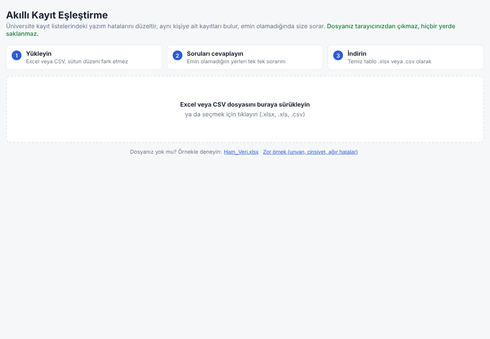
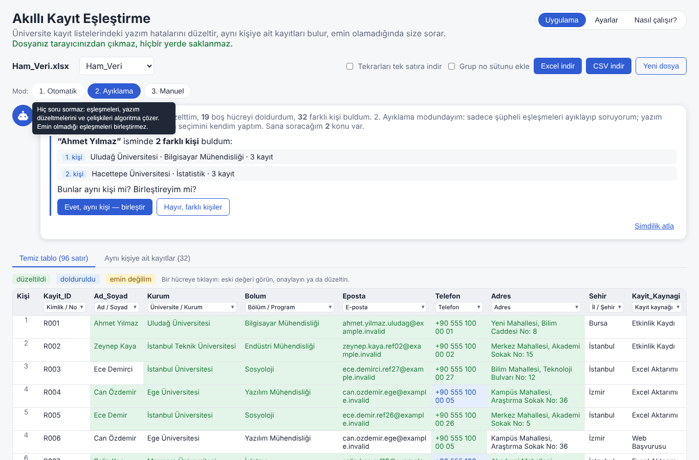
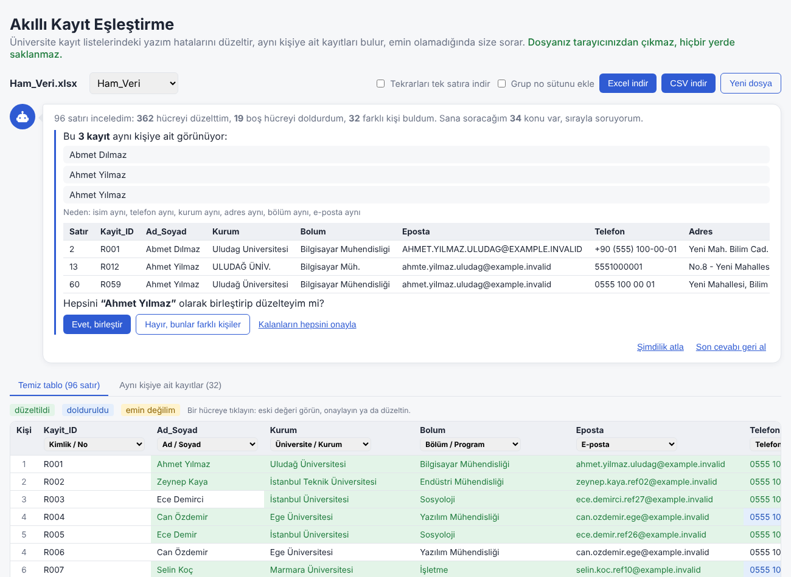
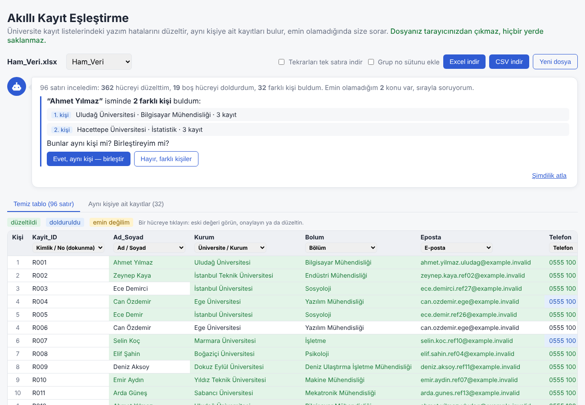
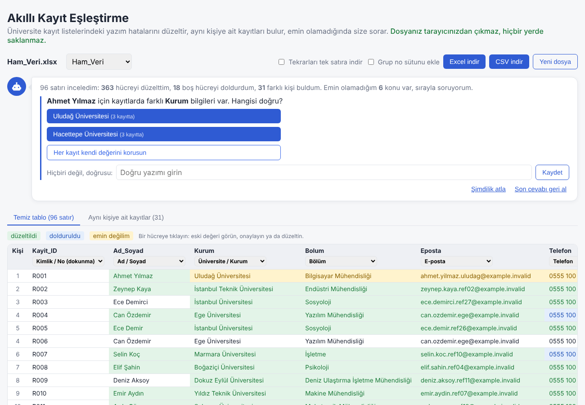
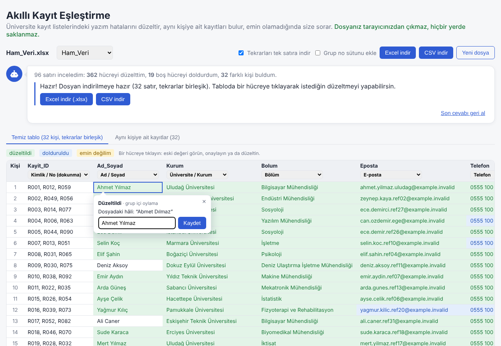
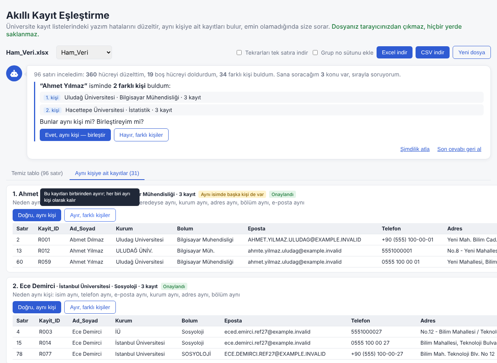
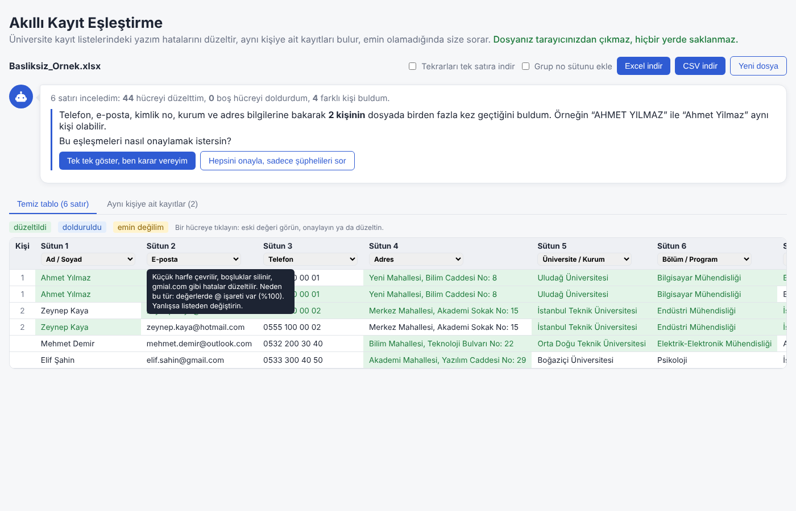

# Akıllı Kayıt Eşleştirme Sistemi

**Canlı uygulama:** https://akilli-kayit-eslestirme.vercel.app

Üniversite kayıt listelerindeki (öğrenci / katılımcı tabloları) yazım hatalarını düzelten, aynı kişiye ait
farklı yazılmış kayıtları bulan ve temizlenmiş tabloyu **.xlsx** veya **.csv** olarak veren web uygulaması.

```
Abmet Dılmaz │ Uludag Universitesi │ Bilgisayar Muhendisligi │ No.8 - Yeni Mahallesi / Bilim Caddesi
        ↓
Ahmet Yılmaz │ Uludağ Üniversitesi │ Bilgisayar Mühendisliği │ Yeni Mahallesi, Bilim Caddesi No: 8
```

- **Konu:** Türkiye'deki üniversiteler: ad soyad (tek veya ayrı sütun), üniversite, fakülte, bölüm, unvan,
  öğrenim düzeyi, cinsiyet, e-posta, telefon, adres, şehir, tarih. Bilinmeyen sütunlar da genel kurallarla temizlenir.
- **Teknoloji:** React + Vite, JavaScript, Excel okuma/yazma için SheetJS
- **Gizlilik:** Dosya tarayıcıdan hiç çıkmaz. Sunucu yok, veritabanı yok, `localStorage` yok.
  Dosya yalnızca sayfanın belleğinde işlenir; sayfa kapanınca hiçbir iz kalmaz.
- **Kullanıcı merkezli:** Algoritma emin olamadığı her konuyu bir **asistan balonunda tek tek sorar**
  ("Bunlar aynı kişi mi?", "Hangi üniversite doğru?", "Doğru yazımı bu mu?"). Kararlar kullanıcınındır.
- **Satırlar:** Varsayılan olarak tüm satırlar korunur, sadece yazımlar düzeltilir. Kullanıcı isterse
  aynı kişinin tekrar eden kayıtları tek satıra indirilir.

## Kullanım

1. Excel veya CSV dosyasını sürükleyip bırakın ya da **örnek dosyayla deneyin**. Çok sayfalı Excel, üstünde
   başlık/açıklama satırı olan tablolar ve Türkçe Windows kodlamalı, `;` ayraçlı CSV'ler de okunur.
2. Her sütunun türü **58 kategoriden** biri olarak tahmin edilir. Önce başlığa, başlık anlamsızsa ("Sütun 1") **içeriğe**
   bakılır. Başlığın üzerine gelince neden o türün seçildiği görünür (ör. *"değerlerde @ işareti var (%100)"*).
   Yanlışsa başlıktaki gruplu listeden değiştirilebilir:

   | Grup | Kategoriler |
   |---|---|
   | Kişi bilgileri | Ad/Soyad, Cinsiyet, Doğum tarihi, Doğum yeri, Yaş, T.C. kimlik no, Uyruk, Medeni durum, Kan grubu, Akademik unvan |
   | İletişim | E-posta, Telefon, Adres, İlçe/Semt, İl/Şehir, Posta kodu, Web sitesi, Sosyal medya hesabı |
   | Eğitim | Öğrenci no, Üniversite/Kurum, Fakülte/Enstitü, Bölüm/Program, Öğrenim düzeyi, Öğretim türü, Sınıf, Not ortalaması, Mezuniyet/giriş yılı, Dil seviyesi, Yabancı dil, Mezun olduğu lise, Burs durumu |
   | İş | Şirket/Firma, Departman/Birim, Pozisyon/Meslek, Sektör, Çalışma şekli, Maaş, İşe başlama tarihi |
   | Kayıt / Etkinlik | Kayıt/başvuru tarihi, Kayıt kaynağı, Durum, Katılım (Evet/Hayır), Ücret/Tutar, Saat, Kategori/Etiket, Puan/Skor, Not/Açıklama |
   | Genel biçimler | Kimlik/No, IBAN, Araç plakası, Tarih, Yüzde, Para tutarı, Yıl, Evet/Hayır, Ülke, Sayı |
   | Diğer | Serbest metin (genel kurallar) |

   **İçerikten tanıma örnekleri:** `@` → E-posta · `05…`, `+90…` → Telefon · "Mah. / Cad. / Sk. / No" → Adres ·
   "Üniv." veya bilinen üniversite → Üniversite · "Müh. / Öğretmenliği" → Bölüm · 81 il adı → Şehir · geçerli 11 hane →
   T.C. kimlik no · `TR..` → IBAN · `34 ABC 123` → Plaka · `K / E` → Cinsiyet · `TL / ₺ / $` → Para · `%` → Yüzde ·
   `0–4` arası ondalık → Not ortalaması · `A Rh+` → Kan grubu · `09:30` → Saat · `Evet / Hayır` · tarih · yıl · bilinen isim → Ad Soyad.
3. **Asistan balonu** özet verir ve emin olamadığı konuları sırayla sorar. Her cevaptan sonra her şey yeniden hesaplanır:
   - **Önce nasıl ilerleyeceğini sorar:** *"32 kişinin dosyada birden fazla kez geçtiğini buldum. Bu eşleşmeleri nasıl onaylamak
     istersin?"* → **"Tek tek göster, ben karar vereyim"** veya **"Hepsini onayla, sadece şüphelileri sor"**.
   - **Tek tek modunda her eşleşme için:** *"Bu 3 kayıt aynı kişiye ait görünüyor: Abmet Dılmaz, Ahmet Yilmaz, Ahmet Yılmaz
     (neden: telefon aynı, e-posta aynı, kurum aynı…). Hepsini “Ahmet Yılmaz” olarak birleştirip düzelteyim mi?"*
     → Evet / Hayır, farklı kişiler / Kalanların hepsini onayla. "Hayır" denen kayıtlar birbirinden ayrılır.
   - **Aynı isimde birden fazla kişi:** *"“Ahmet Yılmaz” isminde 2 farklı kişi buldum (Uludağ · 3 kayıt / Hacettepe · 3 kayıt). Birleştireyim mi?"*
   - **Birleştirince çelişen bilgiler:** *"Ahmet Yılmaz için farklı Bölüm bilgileri var. Hangisi doğru?"* (Kurumda sorulmaz, en uzun ad seçilir.)
     → seçenekler, "her kayıt kendi değerini korusun" veya serbest yazım.
   - **Şüpheli iki kayıt:** *"Bu iki kayıt aynı kişiye ait olabilir (benzerlik %80: isim aynı, kurum aynı). Aynı kişi mi?"*
   - **Emin olunamayan yazım:** *"Ad_Soyad sütununda “eymn blgin” yazıyor. Doğru yazımı “Eymen Bilgin” olabilir mi?"*
     Cevap aynı yazıma sahip **tüm** hücrelere uygulanır.
   - **Son soru:** *"Her kişi tek satır olsun mu?"*
   - "Şimdilik atla" ve "Son cevabı geri al" her zaman kullanılabilir.
   - **Her butonun üzerine gelince** ne işe yaradığını anlatan kısa bir açıklama çıkar.
   - "Aynı kişiye ait kayıtlar" sekmesinde her grup gerekçesiyle listelenir; **"Doğru, aynı kişi"** / **"Ayır, farklı kişiler"**
     butonlarıyla sonradan da karar değiştirilebilir.
4. Tabloda **yeşil** = düzeltildi, **mavi** = aynı kişinin diğer kaydından dolduruldu, **sarı** = emin değilim.
   Bir hücreye tıklayınca **hücre balonu** açılır: dosyadaki eski hâli, değişiklik gerekçesi, "doğru mu?" onayı ve düzeltme kutusu.
5. **Excel indir** veya **CSV indir**. İsteğe bağlı: tekrarları tek satıra indir (kimlik sütunları `R001, R012, R059`
   şeklinde birleşir), grup numarası sütunu ekle.

## Ekran görüntüleri

| | |
|---|---|
|  Giriş: 3 adım ve örnek dosyalar |  Asistan: eşleşmeleri nasıl onaylamak istersin? |
|  "Abmet Dılmaz / Ahmet Yilmaz / Ahmet Yılmaz: birleştireyim mi?" |  Aynı isimde 2 farklı kişi |
|  Birleştirince: hangi kurum doğru? |  Hücre balonu: eski hâli, gerekçe, düzeltme |
|  Gruplar sekmesi ve buton açıklaması |  Başlıksız dosyada türler içerikten tanındı |

## Eşleştirme sistemi nasıl çalışır?

Kod `src/engine/` klasöründedir ve arayüzden bağımsızdır (Node.js'te de test edilir).

| Dosya | Görevi |
|---|---|
| `text.js` | Türkçe büyük/küçük harf, karşılaştırma anahtarı, Damerau-Levenshtein mesafesi |
| `dictionaries.js` | 196 üniversite + kısaltmaları, 119 bölüm, 36 fakülte/enstitü, akademik unvanlar, öğrenim düzeyleri, 81 il, ~430 Türkçe ad/soyad, e-posta alan adları |
| `categories.js` | 58 sütun kategorisi: başlık ipucu, içerikten tanıma kuralı, temizleyici, açıklama |
| `fields.js` | Ad, kurum, bölüm, e-posta, telefon, adres, tarih gibi alanların temizleyicileri |
| `table.js` | Başlık satırını bulma (üstte açıklama satırları olan dosyalar için) |
| `matcher.js` | İki kaydın aynı kişi olup olmadığına karar verme, gruplama |
| `pipeline.js` | Tüm adımları sırayla çalıştıran ana akış |

### Adım 1 — Karşılaştırma anahtarı
Her değer, küçük harfe çevrilip Türkçe karakterleri ASCII'ye indirgenerek bir **anahtara** dönüştürülür:
`"ULUDAĞ ÜNİV."`, `"Uludag Univ"` → `"uludag univ"`. Böylece büyük/küçük harf ve Türkçe karakter farkları
karşılaştırmayı bozmaz. (Türkçe'ye özgü `I/ı`, `İ/i` dönüşümleri `tr-TR` yereli ile yapılır.)

### Adım 2 — Alan bazında temizlik (sözlük + bulanık eşleşme)
- **Üniversite / Bölüm:** Önce kısaltma (`ODTÜ`, `İTÜ`, `DEÜ`, `FTR`, `MBG`, `DUİM`), sonra kelime kısaltmaları açılır
  (`Üniv.` → Üniversitesi, `Müh.` → Mühendisliği), sonra sözlükte birebir arama, sonra yarım kelime eşleşmesi
  (`Turizm İşletm.` → Turizm İşletmeciliği), en son harf hatası toleranslı arama (%85+ benzerlik ve rakipten belirgin üstün).
  Katlanınca iki üniversiteye denk gelen kısaltmalar (`ÇÜ` Çukurova / `CÜ` Cumhuriyet) belirsiz sayılır.
- **Ad Soyad:** Her kelime ad/soyad sözlüğünde aranır. Kısa kelimelerde hata toleransı düşüktür
  (3 harf: 0, 4–7 harf: 1, 8+ harf: 2 harf hatası) ki `Can`/`Cem` gibi farklı isimler karışmasın.
  `Abmet` → `Ahmet`, `Dılmaz` → `Yılmaz`. Kullanıcının özellikle yazdığı Türkçe harfi silen düzeltme yapılmaz
  (`Miraç` → `Mira` olmaz).
- **Dosyadan öğrenme:** Dosyada bir yerde `Kampüs` yazıyorsa başka yerdeki `Kampus` da düzeltilir.
  Dosyada en az iki kez geçen isimler (sözlükte olmasa bile) bilinen isim sayılır; ancak sözlükteki bir isme
  1 harf uzaklıkta olanlar (tekrar eden yazım hatası: `Neihr` ~ `Nehir`) öğrenilmez.
- **E-posta:** boşluklar silinir, küçük harfe çevrilir. İsimle karşılaştırılarak kaymış nokta onarılır
  (`cano.zdemir.ege@` → `can.ozdemir.ege@`).
  Popüler alan adlarındaki hatalar düzeltilir (`gmial.com` → `gmail.com`, `outlok.com`, `.con`).
- **Telefon:** tek biçime: `0555 100 00 01`. **Adres:** `Mah./Cad./Sk./Blv.` açılır, tek biçime getirilir:
  `Yeni Mahallesi, Bilim Caddesi No: 8`. **Şehir:** 81 il listesiyle düzeltilir. **Tarih:** `5.3.1998`, `1998-03-05`,
  Excel tarih sayısı → `05.03.1998`.
- **Unvan / Fakülte / Öğrenim / Cinsiyet:** sözlük + eş anlamlılar (`Araştırma Görevlisi`, `Ars. Gor.` → `Arş. Gör.`;
  `Yrd. Doç. Dr.` → `Dr. Öğr. Üyesi`; `K`, `Bayan` → `Kadın`). Kurum + fakülte birlikte yazılmışsa ikisi de düzeltilir
  (`Uludağ Üniversitesi Tıp Fak.` → `Uludağ Üniversitesi Tıp Fakültesi`).
- **Bilinmeyen sütunlar (genel kurallar):** Katlanınca aynı olan yazımlar (`COCA COLA`, `coca cola`) sütundaki en iyi
  yazıma indirilir; sözlükte olmayan değerler sütundaki çok benzer (%88+) daha sık bir değere çekilir; dosyanın başka
  yerinde Türkçe karakterle yazılmış kelimeler düzeltilir; çoğunluk normal yazılmışsa TAMAMI BÜYÜK değerler düzeltilir.
  Kimlik, sayı (yaş, not, puan) sütunlarına dokunulmaz.
- **Biçim kategorileri:** T.C. kimlik no ve IBAN kontrol hanesiyle doğrulanır; para (`1250 tl` → `1.250 TL`), yüzde,
  not ortalaması (`3.456` → `3,46`), kan grubu (`a rh+` → `A Rh+`), sınıf (`birinci sınıf` → `1. Sınıf`), saat, plaka,
  web adresi, sosyal medya (`instagram.com/x` → `@x`), Evet/Hayır (`x`, `1`, `var`, `✓`) tek biçime getirilir.
  Ülke, dil, dil seviyesi, medeni durum, öğretim türü, kayıt durumu, çalışma şekli sözlük ve eş anlamlılarla düzeltilir.

### Adım 3 — Aynı kişiye ait kayıtları bulma
Benzer isim **tek başına yeterli değildir** (veride "Ahmet Yılmaz – Uludağ" ve "Ahmet Yılmaz – Hacettepe" iki farklı kişidir).
Karar kuralları:

| Durum | Karar |
|---|---|
| İsim benzerliği < %60 | eşleşme yok |
| Telefon veya e-posta eşleşiyor, çelişki yok | **kesin** (isim %75+ ise) |
| Telefon veya e-posta eşleşiyor ama diğeri çelişiyor | **kullanıcıya sor** |
| Telefon veya e-posta çelişiyor | farklı kişi |
| Kimlik bilgisi yok: isim %90+ ve kurum aynı ve adres aynı | **kesin** |
| Kimlik bilgisi yok: isim %85+ ve kurum ya da adres aynı, hiçbiri çelişmiyor | **kullanıcıya sor** |

T.C. kimlik no da telefon/e-posta gibi kimlik bilgisi olarak kullanılır (aynıysa güçlü kanıt, farklıysa farklı kişi).
E-postada sayılar farklıysa (`ali.can.1@` / `ali.can.2@`) farklı kişi kabul edilir. Kesin çiftler birleşim-bul
(union-find) ile gruplara dönüştürülür.

**Aynı isim, farklı kişi:** Gruplamadan sonra aynı isme sahip birden fazla grup kalırsa (ör. Uludağ'daki ve
Hacettepe'deki Ahmet Yılmaz) karar kullanıcıya bırakılır: *"Birleştireyim mi?"*

### Adım 4 — Grup içinde en doğru yazımı seçme
Her alanın değerleri önce **yazım çeşitleri** kümelerine ayrılır (`Ahmet Yılmaz` ~ `Abmet Dılmaz` aynı küme,
`Uludağ Ün.` ile `Hacettepe Ün.` ayrı kümeler).
- **Tek küme (sadece yazım farkı):** adaylar puanlanır: diğer adaylara benzerlik toplamı (çoğunluk + "merkez" yazım)
  + sözlükte bulunma + Türkçe karakter + kullanıcı onayı. Kazanan gruptaki tüm satırlara yazılır, boşluklar doldurulur.
- **Kurum (üniversite) istisnası:** kurumda soru sorulmaz, **her zaman en uzun (en ayrıntılı) ad** seçilir
  (`Uludağ Üniversitesi` / `Bursa Uludağ Üniv.` / `UÜ` → `Bursa Uludağ Üniversitesi`).
- **Birden çok küme (gerçek çelişki):** algoritma tahmin etmez, **"Hangisi doğru?"** diye sorar.
  Adreste kapı numarası farklıysa (`No: 8` / `No: 87`) bu da çelişki sayılır. Cevap gelene kadar
  her satır kendi değerini (düzeltilmiş hâliyle) korur.

### Adım 5 — Emin olunamayan durumlar
Şüpheli çiftler, aynı isimli kişiler, çelişen alanlar ve doğrulanamayan yazımlar soru kuyruğuna girer.
Cevaplar algoritmaya geri beslenir, her şey yeniden hesaplanır. Aynı iki grup için ikinci kez sorulmaz;
"birleştir" cevabının hemen ardından o kişinin çelişen alanları sorulur.

## Test sonuçları

`npm test` komutu ile ölçülür (`tests/evaluate.js`).

**1. Verilen dosya (`tests/data/Ham_Veri.xlsx`):** 96 satır, 32 kişi × 3 kayıt. Doğru gruplar telefon ve e-posta
referanslarına bakılarak elle doğrulandı (`tests/data/Ham_Veri_dogru_gruplar.json`). Beklenen yazım her grubun
"Web Başvurusu" satırıdır.

**2. Sentetik veriler (`tests/generate.js`):** Algoritmanın yalnızca örnek dosyaya göre ayarlanmadığını görmek için
doğru cevabı bilinen veriler üretildi: rastgele kişiler oluşturulup her birinin 1–3 kopyası bozuldu
(Türkçe karakter kaybı, BÜYÜK/küçük harf, harf silme/takas/değiştirme, kısaltmalar, eksik alanlar,
farklı telefon/adres biçimleri, kaymış e-posta noktası). Ek senaryolar farklı dosya biçimlerini dener: ayrı Ad/Soyad
sütunları, unvan/cinsiyet/serbest metin sütunları, gmail/hotmail adresleri ve alan adı hataları. Her senaryo 5 farklı
tohumla çalıştırılır.

**3. Sanal kullanıcı:** Her test iki kez ölçülür. İlkinde hiçbir soru cevaplanmaz. İkincisinde gerçeği bilen bir
"sanal kullanıcı" asistanın sorularını sırayla doğru cevaplar. Böylece sorulu tasarımın gerçekte ne kazandırdığı görülür.

| Test | Satır | Yanlış birleştirme | Bulunan eşleşme | Hücre doğruluğu: önce → sistem | Soru | Sorular cevaplanınca: hücre doğruluğu / bulunan eşleşme |
|---|---|---|---|---|---|---|
| Ham_Veri.xlsx (verilen dosya) | 96 | 0 (kesinlik %100.0) | %100.0 | %43.3 → **%100.0** | 2 | **%100.0** / %100.0 (0 yanlış) |
| Ham_Veri.xlsx – eşleşmeler tek tek onaylanır | 96 | 0 (kesinlik %100.0) | %100.0 | %43.3 → **%100.0** | 34 | **%100.0** / %100.0 (0 yanlış) |
| Sentetik - hafif kirlilik | 396 | 0 (kesinlik %100.0) | %100.0 | %60.4 → **%99.6** | 38 | **%99.7** / %100.0 (0 yanlış) |
| Sentetik - orta kirlilik | 418 | 0 (kesinlik %100.0) | %100.0 | %44.2 → **%99.1** | 46 | **%99.4** / %100.0 (0 yanlış) |
| Sentetik - ağır kirlilik | 405 | 0 (kesinlik %100.0) | %100.0 | %33.8 → **%97.5** | 79 | **%98.1** / %100.0 (0 yanlış) |
| Sentetik - çok sayıda aynı isimli farklı kişi | 398 | 0 (kesinlik %100.0) | %100.0 | %45.5 → **%98.8** | 65 | **%99.3** / %100.0 (0 yanlış) |
| Sentetik - %40 sözlükte olmayan isim | 417 | 0 (kesinlik %100.0) | %99.7 | %44.0 → **%98.8** | 48 | **%99.3** / %100.0 (0 yanlış) |
| Sentetik - telefon/e-posta sütunu yok | 418 | 0 (kesinlik %100.0) | %98.3 | %42.4 → **%99.2** | 50 | **%99.8** / %100.0 (0 yanlış) |
| Sentetik - Ad ve Soyad ayrı sütunlarda | 418 | 0 (kesinlik %100.0) | %100.0 | %45.1 → **%98.9** | 63 | **%99.5** / %100.0 (0 yanlış) |
| Sentetik - ek sütunlar (unvan, cinsiyet, serbest metin) | 418 | 0 (kesinlik %100.0) | %100.0 | %43.7 → **%99.4** | 46 | **%99.6** / %100.0 (0 yanlış) |
| Sentetik - gmail/hotmail adresleri + alan adı hataları | 418 | 0 (kesinlik %100.0) | %100.0 | %42.0 → **%99.1** | 46 | **%99.4** / %100.0 (0 yanlış) |
| Sentetik - başlıklar anlamsız ("Sütun 1, Sütun 2…") | 418 | 0 (kesinlik %100.0) | %100.0 | %43.7 → **%99.4** | 46 | **%99.6** / %100.0 (0 yanlış) |
| Sentetik - hepsi bir arada, ağır kirlilik | 382 | 0 (kesinlik %100.0) | %99.6 | %35.4 → **%98.0** | 88 | **%99.0** / %100.0 (0 yanlış) |

- Kategori tanıma (58 kategori; başlıktan ve başlık anlamsızsa içerikten): 55 / 55 örnek doğru
- Başlık satırı tespiti (üstte açıklama satırları olan dosyalar): tüm örnekler doğru
- Windows-1254 kodlu, ";" ayraçlı, başlığı 3. satırda, Ad/Soyad ayrı CSV (`tests/data/Windows1254_noktali_virgul.csv`): 5 / 5 satır doğru

- **Yanlış birleştirme:** farklı kişilere ait olduğu hâlde "aynı kişi" denen satır çifti. En zararlı hata olduğu için
  tasarım bunu önceliklendirir: tüm testlerde **0**.
- **Bulunan eşleşme:** gerçekte aynı kişi olan çiftlerin ne kadarı bulundu.
- **Hücre doğruluğu:** her hücrenin beklenen temiz değerle birebir aynı olma oranı.

Kalan hataların büyük kısmı ilkesel olarak düzeltilemeyen durumlardır: tek kaydı olan kişinin boş alanı
(doldurulacak kaynak yok) veya sözlükte olmayan ve dosyada hiç doğru yazılmamış isimler (`Tumerkan` → `Tümerkan`).
Bu tür değerler sarı ile işaretlenip kullanıcıya sorulur.

### Geliştirme sürecinde testlerin yakaladığı hatalar
İlk sürüm örnek dosyada %100 başarı verdi, ancak sentetik testler gerçek zayıflıkları ortaya çıkardı:

| Sorun | Çözüm | Etki |
|---|---|---|
| `zeynep.akcali.2@` ve `.3@` %93 benzer → aynı kişi sanıldı | E-postadaki sayılar farklıysa farklı kişi | Kesinlik %56–88 → %100 |
| Tek kez geçen yazım hatası (`Çamkak`) "bilinen isim" öğrenildi | Sadece 2+ kez geçen isimler öğrenilir | |
| Grup içi eşitlikte yanlış aday seçildi | Benzerlik toplamı ile "merkez" yazım seçimi | Hücre doğruluğu %95 → %99 |
| Kimlik sütunu yokken 400 satırda ~290 soru | Kurum/adres çelişkisinde sorma, aynı gruplar için tek soru | 296 → 31 soru |
| `ÇÜ` kısaltması `CÜ` (Cumhuriyet) ile karıştı | Önce birebir kısaltma, katlanmış çakışmalar belirsiz | |
| `Miraç` → `Mira` düzeltildi | Türkçe harfi silen düzeltme yapılmaz | |
| Aynı isimli farklı kişiler kullanıcıya hiç sorulmuyordu (kullanıcı geri bildirimi) | "Birleştireyim mi?" + "Hangisi doğru?" soruları | |
| Grup içinde gerçekten farklı iki değer (iki üniversite) sessizce tek değere indiriliyordu | Yazım çeşidi / gerçek çelişki ayrımı, çelişkide sor | |
| CSV okuyucu `12/11/1975`'i Amerikan tarihi sanıp 11 Aralık yaptı | CSV ham metin olarak okunur, tarih ayrıştırması bizde | |
| "Üniversite" başlığının içindeki "site" yüzünden sütun Web sitesi sanıldı | Başlık kuralları kelime sınırıyla | CSV testi 0/5 → 5/5 |
| "Ankara" değerleri "Ankara Üniversitesi" sanıldı; "Dil Seviyesi" → Yabancı dil | İçerik testlerinde şehir önce, kategori sırası düzeltildi | Tanıma 53/55 → 55/55 |
| Başlıksız sütunlarda içerik tahmini her cevapta yeniden yapılıyordu (yavaş) | Tahmin dosya başına bir kez yapılıp saklanır | |

## Yapay zekâ araçlarının kullanımı

Proje **Claude Code** (Anthropic) ile birlikte geliştirildi:
- **Veri analizi:** Örnek dosyadaki hata türlerinin çıkarılması (kısaltmalar, ASCII yazım, kaymış e-posta noktası,
  adres biçimleri, aynı isimli farklı kişiler).
- **Tasarım ve kod:** Eşleştirme kurallarının (kimlik bilgisi + isim + kurum/adres) tasarımı ve kodun yazılması.
  Kod bilinçli olarak sade tutuldu, her adım açıklama satırlarıyla anlatıldı.
- **Sözlükler:** Üniversite, bölüm, il ve ad/soyad listelerinin hazırlanması.
- **Test ve iyileştirme döngüsü:** Sentetik veri üreteci, sanal kullanıcı ve ölçüm betiği yazıldı; hatalar tek tek
  incelenip yukarıdaki tablodaki iyileştirmeler yapıldı. Arayüz Playwright ile gerçek tarayıcıda baştan sona denendi
  (yükleme → sorular → geri al → hücre balonu → indirme).
- **Kullanıcı geri bildirimi:** İlk sürümü deneyen kullanıcının "aynı isimden birden fazla kişi var, birleştirilsin mi
  diye sorsun, hangisi doğru diye sorsun" geri bildirimi üzerine asistan tasarımı eklendi.

Bütün kararlar (eşik değerleri, "benzer isim tek başına yetmez" ilkesi, emin olunamayınca sorma) test sonuçlarına
bakılarak verildi ve README'de gerekçeleriyle açıklandı.

## Geliştirme

```bash
npm install
npm run dev      # geliştirme sunucusu
npm test         # doğruluk ölçümü (tests/SONUCLAR.md dosyasını da günceller)
npm run build    # yayın için derleme (dist/)
node tests/make-sample.js   # arayüzde denemek için kirli örnek dosya üretir
```

Vercel'de yayında: https://akilli-kayit-eslestirme.vercel.app (Vite, Build: `npm run build`, Çıktı: `dist`).
